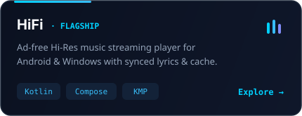
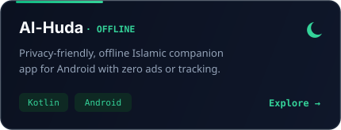
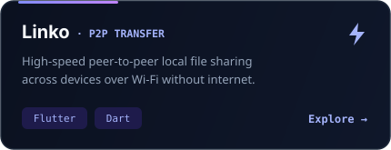

<!-- Animated Custom Hero Banner -->

 

<!-- Animated Typing Tagline -->

 

### Featured Projects

  
  
   
  

   
  
  
  
  

### Tech Stack

  

### Contribution Snake & Streak

  <picture>
    <source media="(prefers-color-scheme: dark)" srcset="https://raw.githubusercontent.com/saferill/saferill/output/github-contribution-grid-snake-dark.svg" />
    <source media="(prefers-color-scheme: light)" srcset="https://raw.githubusercontent.com/saferill/saferill/output/github-contribution-grid-snake.svg" />
    
  </picture>

    

  

### Connect

 

